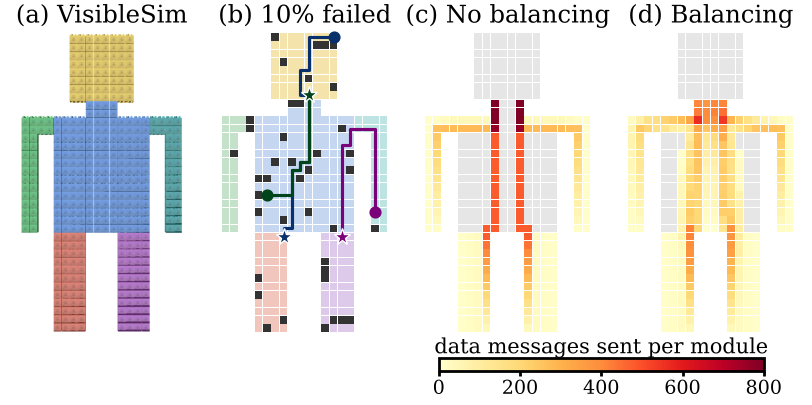

# RADRA: Region-Aware Distributed Routing Algorithm

Code, pseudocode, simulation configurations, results and videos for the paper
*Region-Aware Routing in Distributed Modular Robots*.

N. El Zein, M. Faraj, M. Sabra, P. Tannoury, A. Makhoul.
Université Marie et Louis Pasteur, FEMTO-ST Institute, CNRS, France.

In a modular robot, modules talk only to the modules they touch, so messages are relayed hop by hop.
Applications address *parts* of the robot, such as the head sensors or all modules of a leg, not
module identifiers. RADRA routes packets to these logical **regions**. Every module of a region is a
source of a multi-source gradient, so each module keeps one distance per region, and packets follow
shortest paths in **anycast**, **unicast** and **geocast** modes.

RADRA also:
- detects silent failures and repairs the gradients locally, without counting to infinity;
- recovers the packets held by modules that die (salvage);
- keeps delivering when failures tear a region into pieces;
- uses end-to-end receipts so that every packet whose source and target stay connected is delivered.

<p align="center"></p>

*The 400-module humanoid: (a) its six regions in VisibleSim; (b) after 10 % failures (black),
packets follow shortest surviving paths; (c, d) data messages per module under a hotspot, without
and with load-aware forwarding.*

## Pseudocode

[`docs/algorithms.md`](docs/algorithms.md) gives the three algorithms of RADRA, with an
explanation of each part:
1. region gradients: construction, poisoning and hold-down, failure detection;
2. region-based forwarding and delivery: anycast, unicast, geocast, torn regions;
3. per-link recovery (salvage) and end-to-end receipts.

## Videos

**Screen recordings of VisibleSim** (`videos/simulator/`). These are real runs of the RADRA app in the
simulator GUI. Modules are coloured by region, and failed modules turn red.

| Video | What it shows |
|---|---|
| [`vs_humanoid_failures.mp4`](videos/simulator/vs_humanoid_failures.mp4) | 400-module humanoid, anycast between all regions; 10 % of the modules fail silently at 15 s. |
| [`vs_humanoid2500_failures.mp4`](videos/simulator/vs_humanoid2500_failures.mp4) | The same scenario on the 2,500-module humanoid. |
| [`vs_3d_humanoid_wall.mp4`](videos/simulator/vs_3d_humanoid_wall.mp4) | 3D humanoid (1,264 modules), geocast. A wall of modules fails through the torso and tears it. |
| [`vs_ring_split.mp4`](videos/simulator/vs_ring_split.mp4) | Ring-shaped robot (272 modules), unicast. A failure cuts the ring region into two pieces. |

**Animated traces** (`videos/final/`). These are drawn from the simulator's event logs of the same
code and show what the GUI does not: packets, repairs and load.

| Video | What it shows |
|---|---|
| [`failures_10pct.mp4`](videos/final/failures_10pct.mp4) | 400-module humanoid: 40 modules fail silently at 15 s. Heartbeats detect them, the repair (purple) stays local, and traffic keeps being delivered. |
| [`hotspot_balancing.mp4`](videos/final/hotspot_balancing.mp4) | Arms and legs stream 1,600 packets to the head. Left: always the lowest-id neighbour (two neck columns carry everything, busiest module 800 messages). Right: load-aware forwarding spreads the load over equally short paths (busiest 565, p95 latency 1.81 s → 0.29 s). |
| [`torn_region_ring.mp4`](videos/final/torn_region_ring.mp4) | Ring robot whose region is cut in half. Left: RADRA, 0 of 1,340 packets lost. Right: the same run without torn-region handling, 98 lost. |
| [`videos/early_version/`](videos/early_version) | Eleven slow-motion traces from the **first version** of the protocol, side by side with flooding and BFS trees. They cover one packet hand → head, foot → body, robot sizes 100–1,600, and four failures (shoulder module, BFS root, arm cut off, 5 % random). `v10_fail_armcut` shows the counting-to-infinity problem of that first version, which the final version removes with poisoning and hold-down. |

## Repository layout

```
app/bbRDRM5/      RADRA (VisibleSim app; bbRDRM5 is its historical code name).
                  Also runs the GPSR and Le & Ngo baselines.
app/bbFlooding/   flooding baseline (anycast)
app/bbBFS/        BFS-tree baseline (anycast)
docs/             pseudocode with explanations
configs/          campaign_configs.tar.xz (all robots and scenarios), examples/ (ready to run)
tools/            robot generators, campaign runners, aggregation scripts, video tools
results/          all_runs.csv (21,348 runs), summary tables, raw_results.tar.xz (per-run outputs)
figures/          the humanoid figure and the scripts that draw it
videos/           see above
```

## Build

RADRA is an application of [VisibleSim](https://github.com/VisibleSim/VisibleSim), a discrete-event
simulator for lattice modular robots. We used commit `efeb065`, June 2026. On Linux (or WSL):

```bash
git clone https://github.com/VisibleSim/VisibleSim.git ~/VisibleSim
cd ~/VisibleSim && make            # builds the simulator libraries; see VisibleSim's README for dependencies
git clone https://github.com/dev-loves-code/RADRA.git ~/RADRA
cp -r ~/RADRA/app/* ~/VisibleSim/applicationsSrc/
for a in bbRDRM5 bbFlooding bbBFS; do bash ~/VisibleSim/applicationsSrc/$a/build.sh; done
```

Each `build.sh` builds only its own app into `applicationsBin/<app>/`.

## Run one scenario

```bash
cd ~/RADRA
B=~/VisibleSim/applicationsBin/bbRDRM5/bbRDRM5
$B -c configs/examples/humanoid400_anycast_10pct_failures.xml -t -a 1 | grep RESULT2   # terminal mode
$B -c configs/examples/humanoid400_anycast_10pct_failures.xml -r                       # GUI, starts at once
```

In the GUI, `-r` starts the run in real time. Without it, press `r` to start.

| Example | Robot and scenario |
|---|---|
| `humanoid400_anycast.xml` | 400-module humanoid; every module sends one packet to each other region |
| `humanoid400_anycast_10pct_failures.xml` | same, with 10 % of the modules failing silently at 15 s |
| `humanoid2500_anycast_10pct_failures.xml` | same on the 2,500-module humanoid |
| `humanoid400_hotspot_no_balancing.xml`, `..._balancing.xml` | hotspot toward the head, without and with load-aware forwarding |
| `maze_unicast_cascade.xml` | maze-shaped torso, unicast, cascade of failures over 15 s |
| `3d_cavity__anycast__s1__casc3.xml` | 3D robot with a cavity, anycast, cascade of failures |
| `3d_humanoid_geocast_wall.xml` | 3D humanoid, geocast, a wall of failures tears the torso |
| `ring60.xml` | ring-shaped robot (adversarial case for torn regions) |

The `RESULT2` line gives:
- `packets`;
- `deliverable` (source and target alive and connected at the end);
- `delivered`;
- the messages of each type (`dataMsgs`, `ackMsgs`, `hbMsgs`, `advMsgs`, ...).

`RESULT3` gives latency percentiles and the load per module, and `RESULT6` the end-to-end receipt counters.

**Settings.** Everything is set on the `<experiment>` element of the XML. `profile="final"` (the default)
is the complete algorithm. The main attributes are:
- `traffic=anycast|unicast|geocast|hotspot`;
- `fail=random:<pct>:<seed>`, `failAt`, `failSpread` (µs), `linkLoss`;
- `e2e=on|off` (receipts), `salvage=on|off`, `split=local|none` (torn regions), `balance=detour|none`;
- `baseline=gpsr|lengo` for the two state-of-the-art baselines.

The full list, with comments, is in `app/bbRDRM5/rdrm5Common.hpp` (`struct Experiment` and `parseExperiment`).

**New robots.**
- `tools/make_rdrm2.py out.xml name k shape [key=value ...]` writes a 2D humanoid. `k` sets the size
  (2: 400 modules, 3: 900, 4: 1,600, 5: 2,500), and the shapes are `plain`, `holes`, `maze` and
  `swiss:<pct>:<seed>`.
- `tools/make_rdrm3d.py` and `tools/make_ring.py` write the 3D robots and the ring.

## Reproduce the results

Run the following from the repository root, after `tar -xJf configs/campaign_configs.tar.xz`.
Campaigns run 2 simulations in parallel and skip runs that are already finished, so they can be
stopped and restarted.

| Results | Command | Output |
|---|---|---|
| Comparison with flooding, BFS trees, GPSR and Le & Ngo (552 runs) | Run `python3 tools/bench_sota.py ~/VisibleSim` (RADRA, GPSR, Le & Ngo), then `python3 tools/aggregate_sota.py results_sota2 results_sota`. The flooding and BFS outputs are in `raw_results.tar.xz` (`results_sota/`); `tools/bench_baselines.py` reruns those two apps. | `results/sota2_tables.txt` |
| Reliability: failure timings in 2D, 3D robots, adversarial cases, lossy links | `python3 tools/bench_proof.py ~/VisibleSim timing 3d adv ring` | `results/proof_final_tables.txt`, `results/proof_headline.txt` |
| Ablation (one layer removed at a time) | `VARIANTS=fin,fin_be,abl_notorn,abl_nosalv,abl_dv python3 tools/bench_proof.py ~/VisibleSim timing 3d`, then `python3 tools/ablation_table.py` | `results/ablation_tables.txt` |
| Main campaign (340–2,500 modules) | `python3 tools/bench_final.py ~/VisibleSim`, then `python3 tools/aggregate_final4.py` | `results/final4_tables.json` |
| Humanoid figure and animated traces | `bash tools/make_logs.sh ~/VisibleSim`, then `python3 figures/make_fig.py` and `python3 tools/animate.py failures\|hotspot out.mp4` | `figures/`, `videos/final/` |
| Torn-region video | Run the ring twice with `RR_LOG=<file>.csv` (once as is, once with `split="none" widen="off" e2e="off" gcAck="off"`), then `python3 tools/torn_anim.py configs/examples/ring60.xml fin.csv notorn.csv out.mp4` | `videos/final/torn_region_ring.mp4` |
| Simulator screen recordings | `bash tools/record_vs.sh ~/VisibleSim configs/examples/<scenario>.xml out.mp4 24` (needs Xvfb and ffmpeg) | `videos/simulator/` |

`results/raw_results.tar.xz` holds the per-run outputs of these campaigns, so every table can be rebuilt
with the aggregation scripts without running the simulator. `results/all_runs.csv` lists every run made
during the project (21,348), and `results/FIXES_LOG.md` records each change to the code and its effect.

**Explaining a lost packet.** `RR_LOG=ev.csv $B -c X.xml -t -a 1` writes every send, delivery, drop
and failure. `tools/why_missing.py` and `tools/fate.py` follow each lost packet through that log.

## License

To be decided by the authors before the repository is made public.
VisibleSim is distributed under its own license (see its repository).
